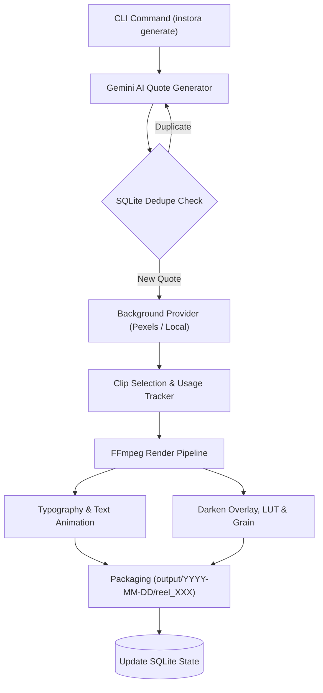

# Instora — Automated Instagram Quote Reel Generator 🎥✨

**Instora** is an automated, AI-driven CLI pipeline that generates high-aesthetic, short-form Instagram reels (1080x1920, 9:16 vertical video) in bulk. It pairs reflective, emotionally resonant quotes generated via Google's Gemini AI with calm, cinematic nature backgrounds, applying professional color grading, overlays, typography animations, and auto-generated captions ready for publishing.

---

## 🌟 Key Features

- **AI-Powered Quote Generation**: Leverages Google Gemini (`google-genai`) to generate structured, themed poetry and reflective lines (in English, Roman Urdu, or Urdu) avoiding cliché tropes.
- **Cinematic Visual Aesthetic**: Modeled on calm, contemplative nature content (inspired by creators like `@degraaf.david`):
  - Golden hour, alpine lakes, mountain peaks, misty sunrises, quiet forests.
  - White, centered reflective typography placed over the calmest areas of the frame.
  - Subdued darkening overlays, subtle film grain (0.05), vignette (0.15), and natural warm color grading.
- **Pluggable Background Providers**:
  - `pexels`: Automated retrieval of royalty-free portrait/landscape footage based on mood keywords.
  - `local_folder`: Pick and rotate curated clips dropped into `assets/backgrounds/`.
- **FFmpeg Video Rendering Engine**:
  - Automatically crops/scales input clips into standard 1080x1920 vertical canvas at 30fps.
  - Dynamic duration calculation based on reading speed (clamped between 7–12 seconds).
  - Staggered line fade or typewriter text animation with soft drop shadows for legibility.
- **Smart Deduplication**: SQLite database tracks quotes, video clips, and rendered reels to ensure zero quote or footage repetition across batches.
- **Export Package**: Each reel is exported into its own dated folder containing:
  - `reel.mp4`: Rendered high-definition 9:16 video.
  - `caption.txt`: Matching reflective caption and targeted hashtags (e.g., `#nature #positivity #naturetherapy`).
  - `meta.json`: Full lineage metadata (quote ID, clip ID, style preset, render timestamp).

---

## 🏗️ Architecture & Data Flow



### Directory Structure (Split Monorepo)

```text
Instagram-Reels/
├── backend/                    # Standalone FastAPI + FFmpeg + yt-dlp service
│   ├── api/                    # FastAPI REST endpoints & static mounts
│   ├── src/instora/            # Core pipeline, AI quotes, YouTube audio & renderer
│   ├── assets/                 # Footage, music tracks & fallback fonts
│   ├── fonts/                  # Typography library + fonts.json
│   ├── styles/                 # Style YAML presets (degraaf.yaml, etc.)
│   ├── config/                 # Runtime cookies & local credentials (gitignored)
│   ├── db/                     # SQLite state DB (gitignored)
│   ├── swap/                   # Staged deliverables & workflow_state.json
│   ├── Dockerfile              # Standalone backend Docker image (Render/Railway/VPS)
│   ├── render.yaml             # Standalone Render blueprint for backend
│   ├── pyproject.toml          # Python package manifest
│   └── requirements.txt        # Python dependencies
├── frontend/                   # Standalone Next.js 14 dashboard & studio editor
│   ├── src/                    # App Router pages, CapCut-style workspace & components
│   ├── public/                 # Static frontend assets
│   ├── next.config.mjs         # Rewrites API/static calls to BACKEND_URL
│   ├── vercel.json             # Vercel project config
│   ├── Dockerfile              # Standalone frontend Docker image
│   └── package.json            # Node dependencies & scripts
├── docker-compose.yml          # Two-service compose (backend + frontend)
├── render.yaml                 # Monorepo Render Blueprint (backend + frontend)
├── start.sh                    # Local runner starting both backend and frontend
└── .gitignore                  # Monorepo ignore rules protecting secrets & media
```

---

## 🛠️ Tech Stack

- **Language**: Python 3.11+
- **AI / LLM**: Google Gemini (`google-genai` SDK)
- **Video Processing**: FFmpeg (system installation) driven via `subprocess`
- **Database**: SQLite (built-in state and deduplication tracking)
- **CLI Framework**: Typer
- **Data Validation & Config**: Pydantic & PyYAML
- **HTTP Client**: HTTPX
- **Logging**: Loguru

---

## 🚀 Getting Started

### 1. Prerequisites
- **Python 3.11+**
- **FFmpeg**: Must be installed and available on system PATH (`ffmpeg -version`).

```bash
# On Ubuntu / Debian
sudo apt update && sudo apt install -y ffmpeg

# On macOS (Homebrew)
brew install ffmpeg
```

### 2. Clone and Setup Environment

```bash
git clone https://github.com/zeishansheikh/Instagram-Reels.git
cd Instagram-Reels

# Create and activate virtual environment
python3 -m venv venv
source venv/bin/activate

# Install dependencies
pip install google-genai typer pydantic python-dotenv httpx loguru pillow pyyaml
```

### 3. Configure API Keys

Copy `.env.example` to `.env` and provide your credentials:

```bash
cp .env.example .env
```

Edit `.env`:
```ini
GEMINI_API_KEY=your_gemini_api_key_here
PEXELS_API_KEY=your_pexels_api_key_here
GDRIVE_FOLDER_ID=your_gdrive_folder_id_here
```

---

## ☁️ Google Drive Background Provider Setup

Instora can automatically scan, stream, and cache footage directly from a Google Drive folder.

### Option A: Direct OAuth Integration
1. Go to [Google Cloud Console](https://console.cloud.google.com/).
2. Create or select a GCP project.
3. Enable the **Google Drive API** under **APIs & Services > Library**.
4. Navigate to **APIs & Services > Credentials** and click **Create Credentials > OAuth client ID**.
5. Select Application type: **Desktop app**.
6. Download the generated client secret JSON, rename it to `credentials.json`, and place it in the project root (it is git-ignored).
7. Copy the folder ID from your Google Drive folder's URL:
   `https://drive.google.com/drive/folders/<GDRIVE_FOLDER_ID>` and add to `.env`:
   ```ini
   GDRIVE_FOLDER_ID=1a2b3c4d5e...
   ```
8. Run the authentication flow once:
   ```bash
   instora gdrive-login
   ```
   This saves an authorized token locally to `token.json` (git-ignored).
9. In `config.yaml`, switch provider:
   ```yaml
   background:
     provider: "gdrive"
   ```

> [!NOTE]
> **Option B (Google Drive for Desktop Sync)**: If you already use Google Drive for Desktop to sync cloud files to your local hard drive, you do **not** need OAuth. Simply keep `background.provider: "local_folder"` and point `paths.backgrounds_dir` in `config.yaml` to your synced local Google Drive folder.

---

## 🎨 Style Presets & Rotation

Instora ships with 3 carefully tuned visual presets keeping a consistent calm, light-first nature aesthetic:

| Preset | Font | Size | Overlay Darkness | Grain / Vignette | Aesthetic Vibe |
| :--- | :--- | :--- | :--- | :--- | :--- |
| `styles/degraaf.yaml` | Sans (`default.ttf`) | 60 | 0.20 | 0.05 / 0.15 | Calm Nature & Grounding |
| `styles/serif_quiet.yaml` | Serif (`serif.ttf`) | 58 | 0.22 | 0.04 / 0.18 | Literary, Quiet & Mindful |
| `styles/sans_minimal.yaml` | Sans (`default.ttf`) | 54 | 0.18 | 0.03 / 0.10 | Airy, Minimalist & Serene |

### Rotating Styles with `--style random`
Pass `--style random` during batch generation to automatically rotate across all presets in round-robin fashion, ensuring aesthetic variety across your reels feed:

```bash
# Rotate styles automatically across 10 reels
instora generate --count 10 --theme hope --lang en --style random

# Or specify a fixed preset
instora generate --count 5 --theme nature --style styles/serif_quiet.yaml
```

---

## 📋 Planned CLI Usage

```bash
# Generate a batch of 10 reels with nature/reflective theme
instora generate --count 10 --theme nature --lang en

# Generate reels with Roman Urdu / Urdu quotes
instora generate --count 5 --theme reflective --lang ur

# Preview a single reel with custom quote
instora preview --quote "Still waters reflect the heavens."

# Clean up cached media and temporary assets
instora clean
```

---

## 📅 Roadmap & Milestones

- [x] **Project Analysis & Foundation**: Complete PRD, architecture, style guide, and repository structure.
- [x] **Phase 0 — Setup**: Virtual environment, FFmpeg verification, initial assets and fonts.
- [x] **Phase 1 — Single Reel Benchmark**: Render one reel end-to-end matching target visual aesthetic.
- [x] **Phase 2 — Gemini Integration**: Prompt engineering, structured JSON validation, SQLite deduplication.
- [x] **Phase 3 — Background Video Management**: Local folder rotation, Google Drive OAuth integration, and Pexels automated retrieval.
- [x] **Phase 4 — End-to-End Batch Pipeline**: Unified CLI for automated batch generation and packaging.
- [x] **Phase 5 — Quality & Presets**: 3 style presets (`degraaf`, `serif_quiet`, `sans_minimal`), `--style random` rotation, luminance contrast sampling, safe margin checks, and interactive review CLI.
- [ ] **Phase 6 — Publishing (Optional)**: Meta Graph API integration or manual Meta Business Suite scheduling.

---

## ⚖️ Ethics & Compliance

- **No Scraping**: No automated scraping of Pinterest or Instagram.
- **Copyright Safe**: Background footage is sourced exclusively from licensed royalty-free repositories (Pexels) or user-supplied local media.
- **Audio Strategy**: Reels are rendered silently by default, allowing creator-selected ambient music from Instagram's native audio library during upload for optimal reach and zero copyright flags.

---

*Authored and maintained by [zeishansheikh](https://github.com/zeishansheikh).*

